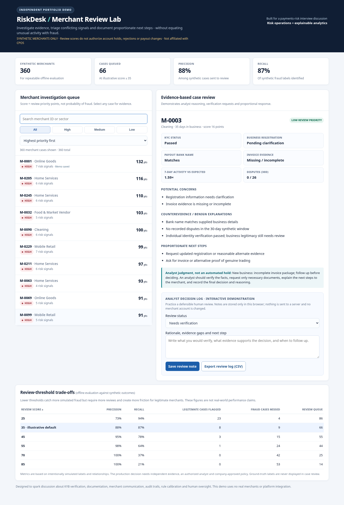

# RiskDesk · Merchant Risk Review Lab

**Interactive portfolio project · Synthetic merchants only · Not affiliated with CPOS or any payments provider**

RiskDesk is an evidence-led payments-risk review prototype. It explores how a fraud analyst can prioritize cases, independently verify contradictory documents, and avoid unnecessarily disrupting legitimate merchants.

[Launch the interactive dashboard](./index.html) (after GitHub Pages is enabled, use the website link under **Settings → Pages**)



## What the dashboard does

- Search and filter **360 reproducible, synthetic merchant cases**.
- View business verification, payout-bank-name consistency, invoice evidence, transaction changes, disputes, and KYC status.
- Separate **risk signals** from **counterevidence**, with context-appropriate next steps.
- Write an analyst rationale, select a *simulated* review status, and export the **client-side review log as CSV**.
- Inspect six illustrative thresholds and their effects on synthetic false positives, missed cases, and review workload.

The score is **only a review priority**, not a fraud probability or a basis for automatically freezing or rejecting accounts. The log lives in your browser; no merchant information goes to a server.

## Three cases for a 2-minute demo

| Merchant | Why it matters | Discussion |
|---|---|---|
| `M-0001` | KYC passed, but bank details and business documents conflict, and disputes are elevated | Escalate evidence verification, not assume guilt |
| `M-0002` | Established weekend seller with a 5.6× spike and corroborating evidence | Do not penalize a legitimate seasonal event |
| `M-0003` | New cleaning business with incomplete, not conflicting, paperwork | Request proportionate alternative evidence |

## Quick start — without any installation

Download/unzip this repository and double-click **`index.html`** (or `run_demo_windows.bat`). No Python, network connection, login, database, or dependency installation is necessary to try the dashboard.

## Run the analysis and tests

Requires Python 3.9+; no external libraries.

```powershell
python analyze.py
python -m unittest discover -s tests -v
python dashboard.py
```

After regenerating, copy `outputs/riskdesk_demo.html` to `index.html` to refresh the published front end. On Windows, `rebuild_windows.bat` performs this sequence with the `py` launcher.

## Publish to GitHub Pages

1. Create a new **public** GitHub repository, for example `riskdesk-merchant-review`. Do not add real merchant information.
2. Upload the **contents** of this folder (including `index.html`) or push the folder with Git.
3. In the repository, go to **Settings → Pages**. Under **Build and deployment**, select **Deploy from a branch**; choose **main** and **/(root)**; click **Save**.
4. Wait for the Pages workflow and use **Visit site** on the Pages settings screen. It may take several minutes to appear.
5. Test `M-0001` and `M-0002` in an incognito browser window, and confirm the note/export controls work.

The live URL usually has the form `https://YOUR-USERNAME.github.io/riskdesk-merchant-review/`. **Do not send this URL until the site actually opens.**

## Project structure

- `index.html` — self-contained interactive website / GitHub Pages entry point
- `generate_data.py` — deterministic synthetic merchant generation
- `core.py` — transparent risk-priority rules and metrics
- `analyze.py` — review queue and threshold calculations
- `dashboard.py` — generates self-contained HTML from the synthetic dataset
- `data/`, `outputs/` — synthetic source data and analysis outputs
- `tests/` — seven unit tests covering core risk policy assumptions
- `PROJECT_WALKTHROUGH.md`, `outputs/case_bank.md` — demonstration script and review memos

## Important caveats

**This is an educational prototype, created with AI assistance.** All merchants and activity are simulated. Classification metrics are derived from synthetic labels and are **not** real-world fraud-detection performance. No real identity documents or payment details are collected. The prototype does not implement KYC/KYB, dispute recovery, legal/compliance obligations, production access control, secure persistence, or authorized account actions.

The user needs to understand, verify, and independently improve the project before describing its work as fully their own. Any real platform implementation would require company policies, audited data access, an authorization model, secure case logs, measurable merchant friction, compliance/privacy review, and retrospective outcome-based calibration.